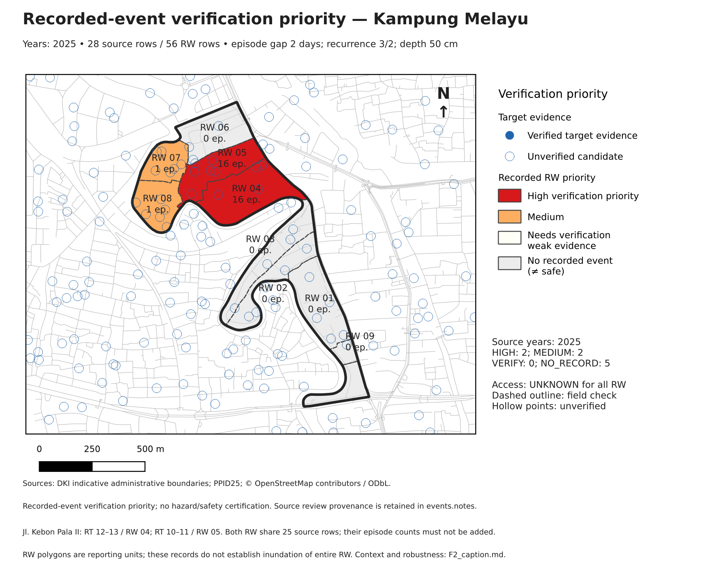
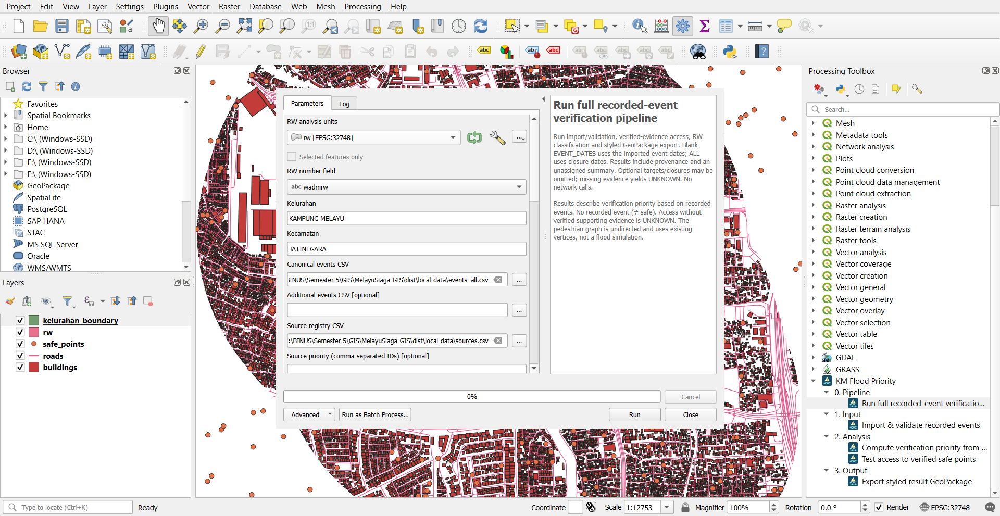
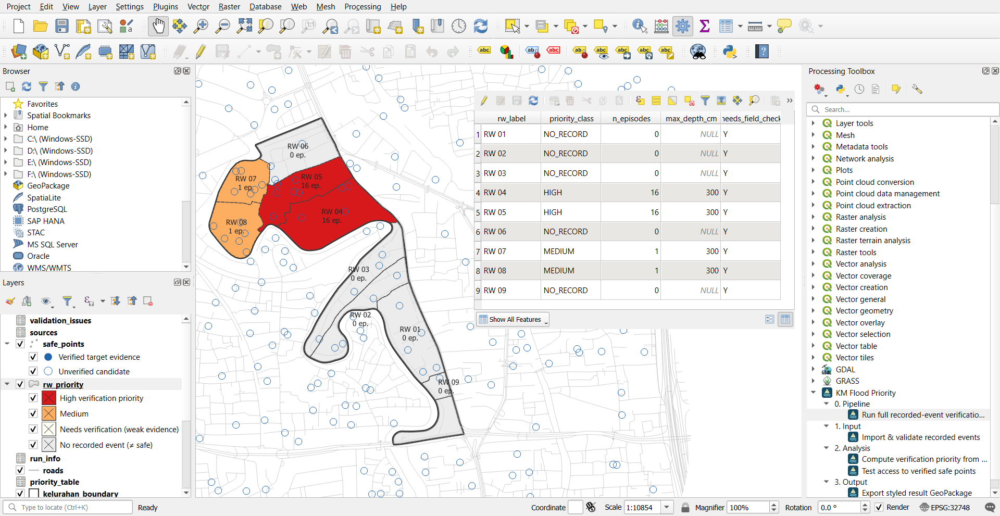
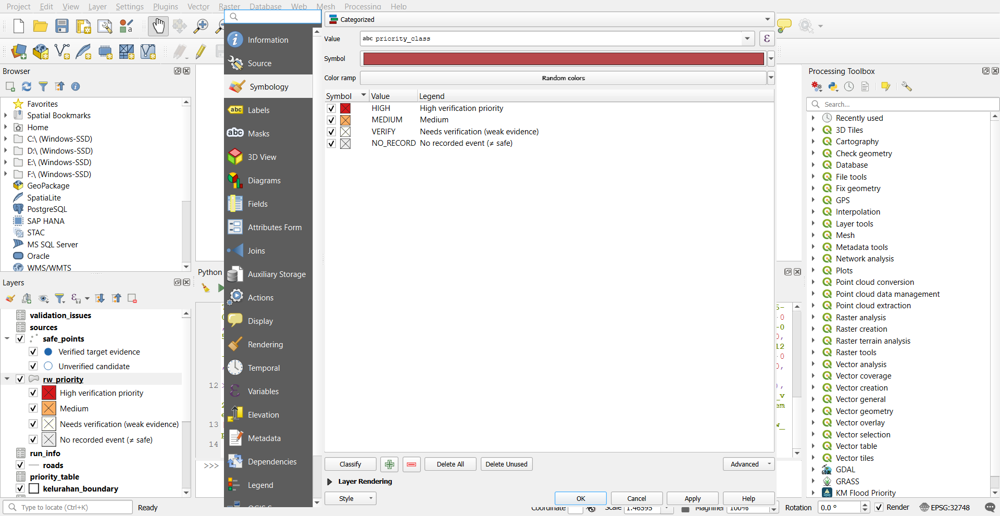

# MelayuSiaga-GIS — KM Flood Priority

A QGIS plugin for **field-verification priority from recorded flood events** in
Kelurahan Kampung Melayu, Jatinegara, Jakarta Timur. The accepted 2025 run covers
nine RW: two HIGH, two MEDIUM and five NO_RECORD (≠ safe), with UNKNOWN access for
all RW. It validates records, groups episodes and writes a styled GeoPackage with
reasons and provenance. Phase 4 was accepted by Raynald on 2026-10-13.



**F2.** RW 04/05 each have 16 episodes from the **same 25 source rows for Jl. Kebon
Pala II: RT 12–13 in RW 04 and RT 10–11 in RW 05**. Do not add their episode counts
or interpret the polygons as whole-RW inundation. RW 07/08 each have one episode;
five RW have NO_RECORD. As context only, Satu Data publisher periods 2019–2020 list
RW 04/05/07/08 in many 2020 months, RW 01–03/06 within January–February 2020, and
no explicit RW 09; dates are unverified and excluded from classification, showing
the limits of the 2025 working set. Excluding Genangan leaves RW 04/05 at **15
episodes each and HIGH**; nine threshold combinations change no class. See the
[full caption](docs/figures/F2_caption.md) and [methodology](docs/METHODOLOGY.md).

## Assignment context

BINUS GIS Final Project. Authors: Raynald Arvan Lim (`raynald.lim@binus.ac.id`),
Alden Viriya Tanudjaja (`alden.tanudjaja@binus.ac.id`), Moses Handoyo
(`moses.handoyo@binus.ac.id`). The study area comprises nine official indicative RW
units, with a measured boundary area of 47.99 ha. Raynald confirmed a group-specific
exception permitting three members on 2026-10-13. Lecturer alignment on study framing
and brief language remains pending.

## Quick start for graders

The installable ZIP is currently **local**; no public release has been published
because the owner requested commits without push. The public plugin build excludes
`sample_data` by Raynald's §6.3 decision on 2026-10-13. Obtain working inputs using
[Reproduce from scratch](#reproduce-from-scratch), or the separate local data bundle
only if the lecturer authorizes its attachment.

1. From a repository copy, build the ZIP with QGIS Python or ordinary Python:
   `python scripts/package_plugin.py`. It creates `dist/km_flood_priority-1.0.0.zip`.
2. In QGIS: Plugins → Manage and Install Plugins → Install from ZIP; select that ZIP.
3. Choose KM Flood Priority → Load sample data. The information message explains
   unresolved redistribution permission and points here. Prepare local inputs.
4. Add all five layers from `inputs.gpkg`. Open Run full pipeline… and select the
   layers, `events_all.csv`, and `sources.csv` using the [parameter table](docs/USER_GUIDE.md).
   Keep defaults `2 / 3 / 2 / 50`, verified-only targets, and choose a new output file.
5. Run and open the result in a fresh project. Inspect `rw_priority`, its reasons,
   `validation_issues`, `access_by_rw`, and `run_info`; embedded styles should load.

| Native Windows evidence | Status |
|---|---|
| S1: provider in Processing Toolbox plus pipeline dialog | Captured on QGIS 3.44.15 Windows |
| S2: styled result map plus rw_priority attribute table | Captured after reopening the result GeoPackage |
| Style recheck v2: automatic categories and five callbacks | PASSED on QGIS 3.44.15 Windows; 1.16 s; no reopening |
| Short demo: install → pipeline → map | `docs/figures/demo.gif` or `demo.mp4`; recording pending |





S1/S2 are genuine Windows screenshots, operated by Claude under Raynald's instructions.
The reported pipeline time is **1.72 s**, with priority_table, access_by_rw and events
identical to Phase 4. S2 demonstrates reopening the package before the GUI auto-load
style fix. The first desktop recheck failed; the replacement build retains callbacks
at module level. **Style recheck v2 passed on Windows QGIS 3.44.15 in 1.16 s**, operated
by Claude on Raynald's laptop under his instructions: five callback entries, five
restored styles and categorized priority without reopening. A read-only comparison
confirmed that priority_table findings match Phase 4, excluding fid/run_id metadata.
Its regression tests also use a fresh completion context and the GUI background task.
See [the acceptance record](docs/PROGRESS.md).



[Style recheck v2 callback log](docs/figures/S2_style_recheck_v2_log.jpg)

<!-- Enable after the actual Windows recording is supplied:

For MP4, use a link to docs/figures/demo.mp4 instead.
-->

F2 is a real map export; S1/S2 are native UI captures. Follow the
[capture checklist](docs/figures/README.md). Automated acceptance covers QGIS
3.44.15/Qt5 and 4.2.3/Qt6. Native Windows pipeline/style acceptance is recorded above.

## What it computes

Import checks schema, source IDs, dates and administrative names; invalid rows are
reported and multi-RW records are expanded without allocating shared impact totals.
Distinct dates separated by at most two days form one episode. Priority uses episodes,
maximum recorded depth, and optional verified access evidence independently.

| Class | Default rule, evaluated in order |
|---|---|
| NO_RECORD | No countable records; **No recorded event (≠ safe)** |
| HIGH | ≥3 episodes AND (maximum depth ≥50 cm OR CUT_OFF access) |
| MEDIUM | ≥2 episodes OR maximum depth ≥50 cm OR CUT_OFF access |
| VERIFY | Remaining countable evidence |

The access graph uses metric road vertices, RW point-on-surface origins and 50 m
snapping. Verified safe points and dated verified closures support REACHABLE/CUT_OFF
testing. Missing evidence yields UNKNOWN. Scenarios never change classes. The current
440 OSM candidates remain unverified, so there are **252 UNKNOWN RW/date rows and
zero routes**; no average baseline distance is claimed. All nine RW need field checks.

## Reproduce from scratch

For the group's next independent check, use
[the clean-clone guide and result form](docs/REPRODUCIBILITY_CHECK.md). A local Git
bundle provides the current branch without pushing; fresh preparation and an
accepted-snapshot pipeline check are recorded separately.

### Windows with QGIS Python

Install QGIS 3.44 LTR from [QGIS Downloads](https://qgis.org/download/), then open its
**OSGeo4W Shell** from the Start menu. Use the bundled QGIS Python launcher rather
than the development `.venv`. Acquisition and input preparation use only the Python
standard library and QGIS's installed bindings; **no pip install is required**.
The [official PyQGIS cookbook](https://docs.qgis.org/3.44/en/docs/pyqgis_developer_cookbook/intro.html#running-custom-applications)
describes why standalone scripts need the QGIS environment. Fresh Windows acquisition
and preparation still need the independent reproduction check; the pipeline itself
has run on Windows, and the preparation scripts have run in QGIS containers.

1. Enter your repository directory and locate the installed launcher. These are
   **cmd / OSGeo4W Shell commands**, not PowerShell. Replace the repository path.

   ```bat
   cd /d "E:\BINUS\Semester 5\GIS\MelayuSiaga-GIS"
   where python-qgis-ltr
   python-qgis-ltr -c "from qgis.core import Qgis; print(Qgis.QGIS_VERSION)"
   ```

   If the launcher is outside PATH, use its full quoted path inside your QGIS
   installation's `bin` folder, ending in `python-qgis-ltr.bat`, in each command
   below. A non-LTR install may provide `python-qgis.bat` instead. If QGIS cannot
   import, stop and share the error and installation folder; do not install PyQGIS
   through pip.

2. Fetch official boundaries, derive the 1000 m metric-buffer bbox, fetch OSM, and
   build the input package. Internet is required for the two fetch commands only.
   Run each command after the previous one succeeds; allow 1–3 minutes for OSM.

   ```bat
   python-qgis-ltr scripts/fetch_admin_boundaries.py
   python-qgis-ltr scripts/build_inputs.py --prepare-bbox-only
   python-qgis-ltr scripts/fetch_osm.py
   python-qgis-ltr scripts/build_inputs.py
   ```

   This ends at **`data/processed/inputs.gpkg`**, ready to add to QGIS and select in
   Run full pipeline. Its five layers are `rw`, `kelurahan_boundary`, `roads`,
   `buildings`, `safe_points`, all EPSG:32748. Inspect `inputs.validation.json`:
   nine valid RW, nonempty roads, and the documented boundary checks must pass.
   The accepted snapshot has 3,154 roads, 34,617 building features and 440 candidates.
   Counts may change on a fresh download. Raw snapshots and checked CSVs are protected;
   reuse existing accepted files or choose a new working copy for a new acquisition.

3. **Human step:** download the [PPID 2025 original PDF](https://timur.jakarta.go.id/ppid/storage/files/setko-260609-075654-x938X6Z0-REKAP_BANJIR_TAHUN_2025_compressed.pdf)
   into `data/raw/ppid/REKAP_BANJIR_TAHUN_2025.pdf`. The accepted file SHA-256 is
   `d1f070b4460f79733b5290abf8857200884eaa4ab24db65665d38c2b767a9708`.

   ```bat
   certutil -hashfile data\raw\ppid\REKAP_BANJIR_TAHUN_2025.pdf SHA256
   ```

   If it differs, inspect the new source before relying on this project's findings.
   For a fresh public reproduction, copy `data/templates/events_template.csv` to
   `data/clean/events_ppid_2025.csv`, transcribe and check the 28 Kampung Melayu
   address rows, citing page/table/NO. Use source ID `PPID25`, ISO dates, both RW
   codes per source row, confidence RW, and verified Y only after the check. Preserve
   Nihil as empty/NULL and use affected totals, not evacuation totals. The group's
   already accepted CSV is available only in its local data bundle. An optional
   development extractor uses pdfplumber; it is **not required** for this QGIS-only
   manual path and its extra packages are not installed into QGIS.

4. Copy `data/templates/sources_template.csv` to `data/clean/sources.csv` and register
   `PPID25`, `DKI-RW`, `DKI-KEL`, and the exact `OSM-YYYYMMDD` ID from the candidate
   CSV. Record URLs, retrieval dates, terms and hashes from the snapshot `.meta.json`
   files; use PPID coverage 2025. Keep every source ID unique. Then validate and merge:

   ```bat
   python-qgis-ltr scripts/merge_sources.py data/clean/events_ppid_2025.csv
   ```

   Require zero schema errors, 28 source rows, 56 normalized RW rows, no duplicates,
   and actual coverage `[2025]`. Satu Data 2019–2020 is context only and excluded;
   see the [source audit](docs/DATA_SOURCES.md#satu-data-granularity-audit--2026-10-12).

5. Use `inputs.gpkg`, `data/processed/events_all.csv` and `data/clean/sources.csv` in
   Run full pipeline. Alternatively, from the same QGIS Shell:

   ```bat
   python-qgis-ltr scripts/run_pipeline_cli.py
   python-qgis-ltr -m scripts.report_results
   ```

   Outputs are `results.gpkg` (eleven application layers/tables plus embedded styles),
   `results.run.json`, and `results.sanity.json`. New reports default to pending
   review; do not copy a previous acceptance onto changed data. The accepted run has
   2 HIGH / 2 MEDIUM / 5 NO_RECORD, zero validation errors/warnings and 252 UNKNOWN
   access rows. UUID, time and GeoPackage byte hash can change on rerun.

### Accepted local snapshot and offline Docker alternative

| Local file | Accepted SHA-256 |
|---|---|
| `data/processed/inputs.gpkg` | `a4be6c4a90bee76b5df32b30961b242b16a5c0604b2667a8e9e63ef410d7305a` |
| `data/processed/events_all.csv` | `7efcb104cf3e7d40e324bc71cd381b5c72db478959cdb59f5c2d0156a5cdfdb6` |
| `data/clean/sources.csv` | `be3da216572a9d24b3da850aab8be054d8c48d5f2b7d6451169b546a23f3ecd9` |

With Docker Desktop running and the tested image already downloaded:

```powershell
.\.venv\Scripts\python.exe scripts/run_pipeline_cli.py --docker
.\.venv\Scripts\python.exe -m scripts.report_results
docker run --rm --network none --mount "type=bind,source=$($PWD.Path),target=/repo" --workdir /repo -e QT_QPA_PLATFORM=offscreen --entrypoint python3 qgis/qgis:3.44.15-noble scripts/render_figures.py
```

Use a new output or explicitly add `--overwrite` after reviewing an existing generated
file. F1 needs the separate official locator acquisition:
`python scripts/fetch_admin_boundaries.py --locator-only`. The current classifier
parameters and versions are recorded in `run_info`. Code is deterministic at the
table level; UUID/timestamps are intentionally new for each run.

## Data sources and licenses

See [DATA_SOURCES](docs/DATA_SOURCES.md) for URLs, precision, dates and SHA-256s.
Inputs use DKI indicative RW/kelurahan boundaries, PPID 2025 records and an OSM
snapshot. **© OpenStreetMap contributors, ODbL.** Satu Data exports remain context
or unresolved source evidence. No synthetic fixtures appear in product maps.

The public plugin ZIP contains no real sample data. A separate, gitignored local
attachment can be built with `python scripts/package_local_data.py`; it contains
`inputs.gpkg`, `events_all.csv`, `sources.csv`, an integrity manifest and instructions.
**Do not commit or release it.** Attach it to the lecturer only with the lecturer's
authorization. This is separate from the installable plugin ZIP.

## Limitations

Recorded coverage is **2025 only**, not a complete flood inventory. Source addresses
support specific RT locations; RW colouring is a reporting-unit summary. Shared
source totals and paired RW episode counts cannot be summed. Five NO_RECORD RW
are not certified safe, and historical context shows the limits of the working set.

All targets remain unverified and no verified closure table is available. UNKNOWN
does not mean reachable or cut off. OSM geometry/connectivity and indicative
boundaries require field checks; the plugin models no water surface or future hazard.
Zero missing depths and zero unassigned rows describe these 28 accepted source rows
only. Three Nihil impact pairs remain NULL, and two source evacuation/affected-count
inconsistencies remain in notes. PPID checking was delegated to Claude by Raynald;
it is not described as direct human row checking.

Windows style recheck v2 passed. The demo, another
member's clean-copy reproduction, lecturer alignment on framing/language, and the
final two-page brief PDF remain pending. The three-member exception is confirmed.
Remote CI/release checks
cannot be claimed while the owner's no-push instruction remains in effect.

## Development

```powershell
python -m venv .venv
.\.venv\Scripts\python.exe -m pip install -r requirements-dev.txt
.\.venv\Scripts\python.exe -m pytest tests/unit --cov=km_flood_priority/core --cov-report=term-missing
.\.venv\Scripts\python.exe -m ruff check km_flood_priority scripts tests
.\.venv\Scripts\python.exe scripts/package_plugin.py
```

Development dependencies are optional for graders; the plugin core uses only the
standard library. Unit acceptance: **116 tests, 99.18% core coverage**.

| Integration runtime | Acceptance |
|---|---|
| `qgis/qgis:3.44.15-noble` / Qt5 | 14 tests pass, including ZIP/CLI, context transfer and GUI worker style loading |
| `qgis/qgis:4.2.3-trixie` / Qt6 | 14 tests pass, including ZIP/CLI, context transfer and GUI worker style loading |
| Native Windows 3.44.15 | Two automated GUI regressions pass; desktop style recheck v2 PASSED in 1.16 s |

Run container integration with `python3 -m pytest tests/qgis -q` using the Docker
mount above. The CI matrix uses both exact tags; remote CI is unrun. Local commits
only; **no push**. See [PROGRESS](docs/PROGRESS.md), [USER_GUIDE](docs/USER_GUIDE.md),
[HUMAN_TASKS](docs/HUMAN_TASKS.md), and the [brief draft](docs/TECHNICAL_BRIEF.md).

## License

Project code is GPL-2.0-or-later. Copyright © 2026 Raynald Arvan Lim,
Alden Viriya Tanudjaja, Moses Handoyo. Data retains its own terms.
