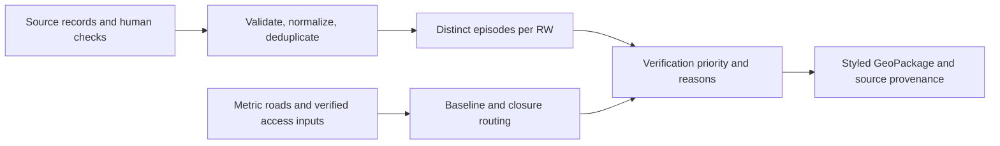

# Methodology

Implementation follows `EXECUTION_SPEC.md` §5 and §7. Analysis uses recorded events
to prioritize field verification at RW scale in Kampung Melayu, Jatinegara.
Every filter checks both administrative names, expands KP. to KAMPUNG, and normalizes whitespace.

## Recorded events and episodes

ISO dates and the required schema/source registry are validated. Invalid individual rows
are excluded with issues; missing columns or zero valid rows fail the import. Multi-RW rows
are exploded. Unknown RW numbers remain unassigned; kelurahan-level evidence is never
distributed across RW. Depth is stored separately in centimetres, with missing/unparsed
values retained as NULL and implausible values above 600 cm flagged for checking.

Cross-source rows sharing a date and normalized RW use one canonical source, chosen by
source priority or known depth followed by CSV order. Other-source rows retain `duplicate_of`
and are excluded from counts. Same-source rows are retained. A countable row has a known RW,
no duplicate marker, and ADDRESS, RT, RW or RW_INFERRED confidence.

Distinct dates are sorted within each RW. Successive gaps of at most two days belong to
one episode; gap zero counts each distinct date separately. Recurrence and maximum
recorded depth remain independent evidence dimensions. Recorded years do not imply
complete observation in all intervening years.

## Verification priority

| Class | Rule, evaluated in order |
|---|---|
| NO_RECORD | No countable record; label: No recorded event (≠ safe) |
| HIGH | At least 3 episodes and either depth ≥50 cm or CUT_OFF access |
| MEDIUM | At least 2 episodes, depth ≥50 cm, or CUT_OFF access |
| VERIFY | Other countable evidence |

Field checking is required if depth is entirely missing, at least half of countable
records have inferred RW, or access is UNKNOWN/NOT_RUN. Within-class rank uses episode
count descending, depth descending (NULL last), then latest date descending. RW number
breaks exact ties deterministically. Scenario membership appears only as a comparison flag.

## Pedestrian network access

Geometry and storage use EPSG:32748 (metres). The QGIS adapter will derive one
`pointOnSurface()` origin per RW. Every road vertex is rounded to 0.01 m; consecutive
vertices create Euclidean edges. Shared vertices connect roads; crossings without a
shared vertex do not connect. Parallel edges are retained. The undirected network
intentionally ignores one-way restrictions for pedestrian movement. Excluded highway
types are motorway, motorway_link, construction, proposed, raceway and bus_guideway.

Origins and targets snap to the nearest vertex within 50 m by default. Multi-source
Dijkstra identifies the nearest eligible target. Only verified safe points are eligible
unless the user explicitly opts into unverified candidates; such runs carry
`targets_verified=N` and `;unverified_targets` in every reason.

Baseline-only runs and dates without verified closures remain UNKNOWN. Off-network
origins and missing usable targets remain UNKNOWN. For a date with verified closures,
matching OSM road IDs or normalized names are removed: a remaining path gives REACHABLE,
and no path gives CUT_OFF. Baseline distances are retained independently. The worst event
status is CUT_OFF > UNKNOWN > REACHABLE; baseline rows do not affect priority.

The core is implemented and unit-tested. QGIS adapters, the real-data run, figures and
threshold sensitivity are still pending their phase gates. No hazard estimate is produced.

