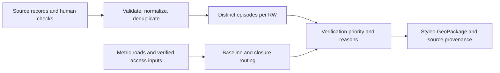

# Methodology

Implementation follows `EXECUTION_SPEC.md` §5 and §7. Analysis uses recorded events
to prioritize field verification at RW scale in Kampung Melayu, Jatinegara.
Every filter checks both administrative names, expands KP. to KAMPUNG, and normalizes whitespace.

## Recorded events and episodes

ISO dates and the required schema/source registry are validated. Invalid individual rows
are excluded with issues; missing columns or zero valid rows fail the import. Multi-RW rows
are exploded. Unknown RW numbers remain unassigned; kelurahan-level evidence is never
distributed across RW. Depth is stored separately in centimetres, with missing/unparsed
values retained as NULL and implausible values above 600 cm flagged for checking.

Cross-source rows sharing a date and normalized RW use one canonical source, chosen by
source priority or known depth followed by CSV order. Other-source rows retain `duplicate_of`
and are excluded from counts. Same-source rows are retained. A countable row has a known RW,
no duplicate marker, and ADDRESS, RT, RW or RW_INFERRED confidence.

Distinct dates are sorted within each RW. Successive gaps of at most two days belong to
one episode; gap zero counts each distinct date separately. Recurrence and maximum
recorded depth remain independent evidence dimensions. Recorded years do not imply
complete observation in all intervening years.

## Verification priority

| Class | Rule, evaluated in order |
|---|---|
| NO_RECORD | No countable record; label: No recorded event (≠ safe) |
| HIGH | At least 3 episodes and either depth ≥50 cm or CUT_OFF access |
| MEDIUM | At least 2 episodes, depth ≥50 cm, or CUT_OFF access |
| VERIFY | Other countable evidence |

Field checking is required if depth is entirely missing, at least half of countable
records have inferred RW, or access is UNKNOWN/NOT_RUN. Within-class rank uses episode
count descending, depth descending (NULL last), then latest date descending. RW number
breaks exact ties deterministically. Scenario membership appears only as a comparison flag.

## Pedestrian network access

Geometry and storage use EPSG:32748 (metres). The QGIS adapter derives one
`pointOnSurface()` origin per RW. Every road vertex is rounded to 0.01 m; consecutive
vertices create Euclidean edges. Shared vertices connect roads; crossings without a
shared vertex do not connect. Parallel edges are retained. The undirected network
intentionally ignores one-way restrictions for pedestrian movement. Excluded highway
types are motorway, motorway_link, construction, proposed, raceway and bus_guideway.

Origins and targets snap to the nearest vertex within 50 m by default. Multi-source
Dijkstra identifies the nearest eligible target. Only verified safe points are eligible
unless the user explicitly opts into unverified candidates; such runs carry
`targets_verified=N` and `;unverified_targets` in every reason.

Baseline-only runs and dates without verified closures remain UNKNOWN. Off-network
origins and missing usable targets remain UNKNOWN. For a date with verified closures,
matching OSM road IDs or normalized names are removed: a remaining path gives REACHABLE,
and no path gives CUT_OFF. Baseline distances are retained independently. The worst event
status is CUT_OFF > UNKNOWN > REACHABLE; baseline rows do not affect priority.

The core and QGIS adapters are implemented and tested on QGIS 3.44.15/Qt5 and 4.2.3/Qt6.
The plugin uses the four child Processing algorithms for its main pipeline; normalized
events preserve verification/source-inconsistency notes. Every spatial result carries
its default QML in the GeoPackage. Export requires explicit replacement consent for an
existing output and completes a temporary package before replacement.

For the current 2025 working set, Raynald explicitly accepted Claude's delegated
independent second check and authorized the 28 source rows as Y/RW. This exception
does not claim direct human visual checking; three Nihil impact pairs remain NULL.
Two source evacuation/affected-count inconsistencies are recorded without changing
JUMLAH TERDAMPAK values. Other source and candidate verifications are unaffected.

## Accepted 2025 run and robustness

Raynald accepted the Phase 4 results and framing on 2026-10-13. The 28 source rows
produce 56 normalized RW rows: two HIGH (04/05), two MEDIUM (07/08), five NO_RECORD.
Each of RW 04/05 has 16 episodes from the same 25 source rows for Jl. Kebon Pala II,
RT 12–13 in RW 04 and RT 10–11 in RW 05. These episode counts must not be added
across RW, and the RW polygons do not establish whole-RW inundation. RW 07/08 each
have one episode from three shared source rows. All nine RW require field checks:
252 RW/date access rows are UNKNOWN because no safe point is verified. No route or
average baseline distance is available under the verified-only default.

Nine sensitivity combinations (REC_HIGH 2/3/4 × DEPTH_HIGH_CM 30/50/80, keeping
REC_MED=2 and the two-day episode gap) leave every class unchanged. Excluding five
Genangan source rows removes ten normalized rows; RW 04/05 still have 15 episodes
each and remain HIGH. These checks assess stability within the accepted working set.

As context only, Satu Data publisher periods 2019–2020 list RW 04/05/07/08 in many
2020 months, RW 01–03/06 within January–February 2020, and no explicit RW 09; event
dates are unverified and excluded from classification, so NO_RECORD and one episode
in RW 07/08 reflect limitations of the 2025 data. No absence of flooding is inferred.

F1/F2/F3 are headless exports of actual results. S1/S2 are genuine Windows UI
screenshots, operated by Claude under Raynald's instructions, reported on 2026-10-13.
The Windows pipeline took 1.72 s with three result tables identical to Phase 4,
according to Raynald. S2 shows the reopened package before the GUI style repair.
The repair restores embedded styles from the final package after Processing's GUI
loader has added the layers; it changes presentation only. Additional years require
resolved source/date/RW evidence and
new input acceptance. The report is `data/processed/results.sanity.json`, with
`result_review = "Accepted by Raynald 2026-10-13"` for this accepted run.

