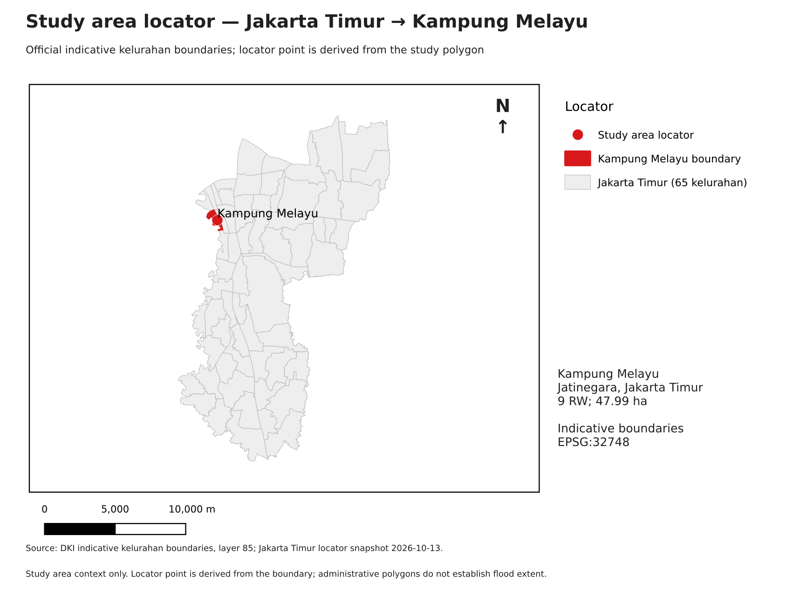
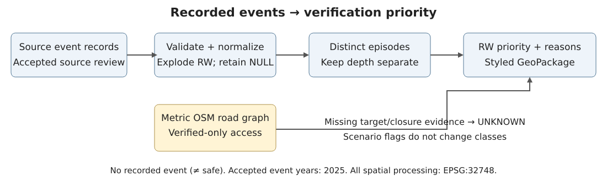

# KM Flood Priority — technical brief draft

**Raynald Arvan Lim · Alden Viriya Tanudjaja · Moses Handoyo**

BINUS GIS Final Project · Phase 4 accepted by Raynald, 2026-10-13

Editorial note: finalize in Word/Google Docs and export **at most two A4 pages**.
Default language: English. Lecturer framing/language alignment remains pending;
the three-member group exception is confirmed and Windows screenshots are available.
Use F1/F3 as small insets and F2 as the main map; keep this note outside the final PDF.

## Problem and study area

Flood reports identify affected addresses, but repeated dates, shared RW labels and
missing evacuation evidence complicate field-verification decisions. KM Flood Priority
turns traceable records into a reproducible RW verification order with explicit reasons.
The study focuses on Kelurahan Kampung Melayu, Jatinegara, Jakarta Timur: **nine RW
and 47.99 ha**, measured from official indicative polygons in EPSG:32748. The output
summarizes recorded evidence; it does not predict flooding or certify evacuation safety.

## Data

| Source | Coverage and use |
|---|---|
| PPID Kota Jakarta Timur flood recap | 2025; 28 accepted address rows → 56 RW rows; page/table/NO references |
| Satu Data Jakarta export | Publisher periods 2019–2020: context only; dates unverified, excluded from classification |
| DKI indicative RW boundaries | Nine reporting units; snapshot 2026-10-12 |
| DKI indicative kelurahan boundaries | Study extent; 65 Jakarta Timur polygons acquired 2026-10-13 for F1 |
| © OpenStreetMap contributors / ODbL | 2026-10-12; 3,154 road features, 34,617 building features, 440 unverified candidate points |
| Safe-point / closure evidence | No verified targets or closure table supplied; UNKNOWN access |

PPID checking was delegated to Claude by Raynald and accepted by Raynald. Three
Nihil impact pairs remain NULL. Source NO 15 (6 July) and NO 20 (7 July) have
inconsistent evacuation totals; affected totals are retained with notes. Complete
URLs, checksums and precision limits: [DATA_SOURCES](DATA_SOURCES.md).

## GIS method

Validate schema, dates, names and source IDs; expand multi-RW rows while retaining
provenance and shared totals. Group distinct dates with gaps ≤2 days into episodes.
HIGH requires ≥3 episodes plus maximum depth ≥50 cm or CUT_OFF evidence; MEDIUM
requires ≥2 episodes, depth ≥50 cm or CUT_OFF; remaining records yield VERIFY.
Zero countable records yield **NO_RECORD (≠ safe)**. An undirected metric road graph
uses RW point-on-surface origins and 50 m snapping; verified targets and dated verified
closures support access testing. Missing evidence yields UNKNOWN. Export includes
styles, validation issues, reasons, parameters, versions and run metadata.

## Spatial findings and limits

**Two of nine RW are HIGH:** RW 04/05 each have 25 records, 16 episodes and a 300 cm
source maximum. They share the **same 25 rows for Jl. Kebon Pala II, RT 12–13 in RW
04 and RT 10–11 in RW 05**. Their episode counts must not be added; entire RW
inundation is not established. **Two RW are MEDIUM:** RW 07/08 each have three
records, one episode and a 300 cm source maximum. Five RW have NO_RECORD. None
of the 28 source rows lacks depth or RW identity. **All nine RW have UNKNOWN access**
(252 RW/date rows): zero verified targets, zero routes, no claimed baseline average.

As context only, Satu Data publisher periods 2019–2020 list RW 04/05/07/08 in many
2020 months, RW 01–03/06 within January–February 2020, and no explicit RW 09;
unverified dates are excluded from classification, showing that NO_RECORD and one
episode in RW 07/08 are limits of the 2025 working set. Excluding five Genangan
rows leaves RW 04/05 at **15 episodes each and HIGH**. All **nine** threshold
combinations (recurrence 2/3/4 × depth 30/50/80 cm) preserve classes.

F2 caption: [specific RT locations, context and robustness](figures/F2_caption.md).
Polygon colours summarize reporting units, not inundation extent or uniform depth.

## Proposed solution and product

Verify the cited locations in RW 04/05 first, then RW 07/08; inspect recurrence,
drainage and preparedness at the recorded addresses. Check NO_RECORD units for
missing reporting. Obtain source-backed safe points, capacity and dated closures
before using route outputs for planning. Require RW/RT on future reports.

The plugin offers five Processing algorithms and an offline pipeline. Local automated
checks passed **116 unit tests (99.18% core coverage)** and **14 integration tests
in each of QGIS 3.44.15 and 4.2.3**. Raynald reported **1.72 seconds** on Windows
QGIS 3.44.15, operated by Claude under his instructions, with three result tables
identical to Phase 4. Public plugin ZIP excludes
sample_data by the group's licensing decision. The separate local data bundle is
for a lecturer attachment only if authorized.
Automatic-style desktop recheck v2 passed on Windows QGIS 3.44.15 in **1.16 s**,
operated by Claude on Raynald's laptop under his instructions. Five callbacks
restored styles without reopening; priority_table findings match Phase 4.

Repository: [MelayuSiaga-GIS](https://github.com/DlegendZ/MelayuSiaga-GIS). Public
release: [KM Flood Priority v1.0.0](https://github.com/DlegendZ/MelayuSiaga-GIS/releases/tag/v1.0.0).
Release-source CI passed for unit tests and both QGIS versions; the attached ZIP
is the unchanged Windows-accepted build, without sample_data.

S2 is a genuine Windows screenshot, operated by Claude under Raynald's instructions,
after reopening the result GeoPackage before the automatic GUI style loading fix.
It demonstrates the package style, not a manual rerun of that fix. Finalize the
brief layout to at most two A4 pages.
